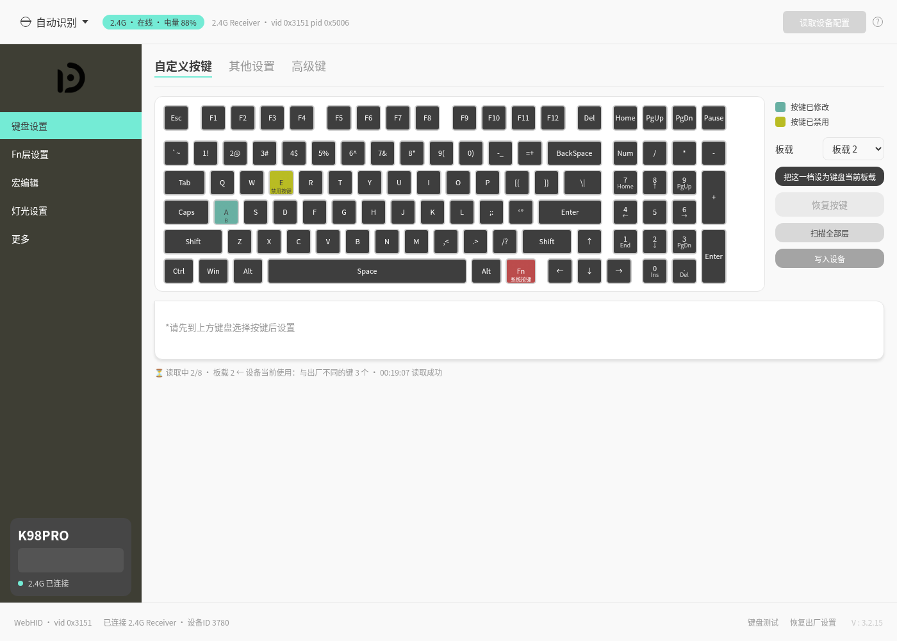

# DAGK K98 PRO V2 · 网页版驱动

**不用装任何软件**，在 Chrome / Edge 打开网页，即可配置 **DAGK K98 PRO V2** 键盘：
改键、调灯效、录宏、管配置 —— 有线（USB）和 2.4G 无线均可，Windows / Linux / macOS 都能跑。

本项目基于原厂 Windows 驱动进行逆向工程实现，仿照原版驱动实现了**除 AI 之外的全部功能**。

- 🌐 在线使用：<https://dagk.mxgame.top>
- 📦 源码：<https://github.com/MingxuanGame/DAGK-K98PROV2-driver>

> ### 🤖 这个项目是 AI 生成的
>
> 本仓库的代码、测试和文档都由 **AI 编码代理** 在人工指导下完成。
> 协议已经在真机验证，并且和原厂驱动发出的帧做过**逐字节比对**（`npm run test:frames`）。
> 即便如此，请把它当作"第三方工具"来对待：**升级固件请用原厂工具，重要配置先导出备份**。

> ### ⚠️ 非官方项目
>
> 与 DAGK 没有任何关系，不是官方驱动。商标与固件版权归 DAGK 所有。
> 仓库里不包含原厂安装包和任何厂商二进制文件。



---

**目录**

- [1. 它能做什么](#1-它能做什么)
- [2. 快速开始](#2-快速开始)
- [3. 常见问题](#3-常见问题)
- [4. 部署到公网（SaaS / 静态托管）](#4-部署到公网saas--静态托管)
- [5. 技术细节](#5-技术细节)
- [6. 开发 / 测试](#6-开发--测试)
- [7. 许可与免责](#7-许可与免责)

---

## 1. 它能做什么

| 页面 | 能做的事 |
|---|---|
| **键盘设置** | 98 键键盘图，点任意键改键：组合键 / 宏 / 功能键 / 禁用按键 / 扩展区（多媒体、浏览器、系统键…）；**104 键盘选键面板**；三个板载档位（板载 1/2/3）分别读 / 写 |
| **Fn 层设置** | Fn 层单独改键，可选 **Win / Mac** 两套系统；改法与主键盘一致 |
| **宏编辑** | 多槽位宏，支持按下 / 抬起 / 延时 / 鼠标动作，可设循环次数、固定间隔、按下播放 / 开关播放 |
| **灯光设置** | 主灯效 **21 种**（随波逐流、繁星点点、动态呼吸、音乐律动…）+ 亮度 / 速度 / 颜色（炫彩或自定义 8 色）；侧灯灯带；**单键背光**逐键涂色 |
| **更多** | 设备设置（回报率 / 去抖 / 系统模式 / WASD 互换 / 各种休眠时间）、**配置管理**（从设备读取、应用到设备、导出 / 导入 .json、保存到浏览器多套配置）、高级诊断（实时日志、单页探测、软复位 HID） |
| **键盘测试** | 底栏打开，按本键盘的 98 键布局排布，按键亮起即表示导通正常 |

还有一些细节：

- **改动没写入会提醒**：顶栏出现"有改动未写入"徽标，刷新 / 关闭页面前会再确认一次。
- **设备掉线有通知**：页面横幅 +（本地服务在跑时）系统通知，插好后一键重连。
- **2.4G 也很稳**：默认不做任何后台轮询（这个接收器的厂商通道很敏感），需要看状态时手动点一下。

## 2. 快速开始

### 准备

- **浏览器**：Chrome / Edge **89 或更高**（需要 WebHID）。Firefox、Safari 目前不支持。
- **键盘连接方式**：USB 数据线或 2.4G 接收器。**蓝牙模式不支持**。
- **Linux 用户**：需要给设备放行（见第二步）。Windows / macOS 不需要额外配置。
- **系统**：Windows / Linux / macOS 都可以，只要浏览器支持 WebHID。

### 第一步 · 打开驱动页面

**方式 A：用已经部署好的页面**（推荐）

前往 <https://dagk.mxgame.top> 即可使用，无需安装任何东西。

**方式 B：本地启动**

仓库自带一个零依赖的小服务器：

```bash
git clone https://github.com/MingxuanGame/DAGK-K98PROV2-driver.git
cd DAGK-K98PROV2-driver
npm run dev            # = node tests/serve.mjs 8177
```

然后浏览器打开 **<http://127.0.0.1:8177/web/index.html>**

> 也可以把 `web/` 目录丢给任意静态服务器，或者直接部署到公网（见第 4 节）。
> 本地服务器额外提供一个"系统通知"桥：键盘掉线时能在桌面上弹通知。

### 第二步 · Linux 放行 HID 设备（其他系统跳过）

浏览器要访问 `/dev/hidraw*`，默认只有 root 能读写，所以要装一条 udev 规则：

```bash
sudo cp 70-dagk-k98pro.rules /etc/udev/rules.d/
sudo udevadm control --reload-rules
sudo udevadm trigger --action=add --subsystem-match=hidraw

# 拔插一次键盘/接收器，然后确认权限里有你的用户名：
getfacl /dev/hidraw* | grep "$USER"        # 期望看到 user:你的用户名:rw-
```

### 第三步 · 连接并开始使用

1. 打开页面 → 点「**连接有线键盘**」或「**连接 2.4G 接收器**」；
2. 浏览器弹出设备选择框 → 选中 K98PRO（首次必须手选，之后浏览器会记住授权）；
3. 连上后**会自动把键盘配置读回来**（当前板载那一档 + 灯效 + 设置），直接就能改。

改键流程：**点键盘图上的键 → 在下面选新功能 → 点「写入设备」**。
写之前顶栏会提示有改动未写入；不确定就点右上角「读取设备配置」重新读一遍。

## 3. 常见问题

**Q：点了连接，弹窗里没有设备 / 列表是空的？**
A：① 确认键盘已插好、开关拨在有线或 2.4G 档；② Linux 看第二步的权限；
③ 换 Chrome / Edge；④ 页面必须是 `https://` 或 `http://127.0.0.1`（WebHID 要求安全上下文）。

**Q：Linux 上 `getfacl` 看不到自己的用户名？**
A：udev 规则文件名必须以数字开头（如 `70-`），装完要拔插一次设备。

**Q：读取配置提示"设备没有响应"？**
A：2.4G 下先把键盘开关拨到 2.4G **并按一下键唤醒**（键盘睡着时接收器转发不过去）。
仍然不行就点「更多 → 软复位 HID 连接」，或者拔插一次接收器。

**Q：改了键、也点了写入，但键盘上没变化？**
A：改动只会写进**当前选中的板载档**。如果键盘现在用的是"板载 2"，而你在编辑"板载 1"，
需要点「**把这一档设为键盘当前板载**」切过去（或在键盘上用 Fn 组合切档）。

**Q：为什么 2.4G 有时候过一会儿就断？**
A：这个接收器的厂商配置通道很"脆"，历史上出现过每 15~30 秒自重置的问题（硬件层面）。
本页面为此做了很多让步：不做后台轮询、一次只发一条命令、失败立刻停手。
如果频繁掉线，优先用有线，或者换个 USB 口直插主机（别走 HUB）。

**Q：能刷固件吗？**
A：不能。刷写需要让键盘重新枚举成 Bootloader，浏览器做不到（原厂也是靠本地服务完成的）。
请用原厂工具在有线模式下升级。

**Q：和原厂驱动比少了什么？**
A：只有 **AI 功能**（原厂那个"AI 改键 / AI 助手"），以及需要厂商服务器的东西（社区分享；
音乐律动 / 光影的音频采集需要本地 IOT 服务）。其余功能都在，包括原厂的全部改键类型。

## 4. 部署到公网（SaaS / 静态托管）

这个项目**没有后端**，整个应用就是 `web/` 目录里的静态文件，
所以任何静态托管都能放：Vercel、Cloudflare Pages、Netlify、GitHub Pages、对象存储、自己的 nginx…

要点只有四条：

1. **必须 HTTPS**（WebHID 要求安全上下文；`localhost` 例外）；
2. **发布目录 = `web/`**（仓库里已经写好 `vercel.json`，别的平台照抄配置即可）；
3. **换域名时改三处**：`web/index.html`（canonical / og:url / og:image / JSON-LD）、
   `web/sitemap.xml`、`web/robots.txt` —— 现在写的都是 `https://dagk.mxgame.top`；
4. 可选：给响应加一条 `Permissions-Policy: hid=(self)`。
   另外注意 `/api/ping`、`/api/notify`（系统通知桥）在公网上不存在 ——
   页面会自动降级成横幅提醒，不会报错。

最省事的两种方式：

```bash
npx vercel --prod          # 仓库里已有 vercel.json（outputDirectory = web）
# Cloudflare Pages / Netlify：构建命令留空，发布目录填 web
```

详细步骤（GitHub Pages、nginx / Caddy、Docker、自定义域名与响应头）见
**[docs/deploy-saas.md](docs/deploy-saas.md)**。

> 部署到公网后，**Linux 使用者仍然要在自己机器上装 udev 规则** —— 浏览器能不能拿到设备
> 由本机决定，和网页放在哪里无关。

## 5. 技术细节

- 原厂是 Electron + React，底层其实用的就是 **WebHID**（不是 Web Serial），
  所以"用网页复刻"在原理上是可行的。
- 厂商通道是 **interface #2**（`usagePage 0xFFFF / usage 0x0002`），
  64 字节 **Feature Report**，`reportId = 0`；写用 SET_FEATURE，读用 GET_FEATURE。
- 每条帧带两个校验字节：`f[7] = 0xFF - sum(f[0..6])`、`f[8] = 0xFF - sum(f[0..7])`。
- 2.4G 接收器只是"转发器"：`0xF7` 查链路状态 → `0xF6` 选目标（键盘 = 10）→ 发命令 →
  `0xFC` 通知读取 → 取回同一个 64 字节报文。
- 按键配置 = **128 个位置 × 4 字节 = 512 B / 层**，共 3 层（板载 1/2/3）。
  普通键写 `[0,0,HID码,0]`，组合键写 `[0,修饰键,键1,键2]`。
- 页面做了基本的 SEO 与分享优化：标题 / 描述 / canonical、Open Graph 与 Twitter 卡片、
  `WebApplication` 结构化数据、`sitemap.xml` / `robots.txt` / `site.webmanifest` / `404.html`，
  以及无 JS 时的 `<noscript>` 兜底内容。

想看完整对照表和真机测试记录，去 `docs/`：协议 [docs/protocol-parity.md](docs/protocol-parity.md)、
真机验证 [docs/hardware-test-results.md](docs/hardware-test-results.md)、
无线 [docs/wireless.md](docs/wireless.md)。

## 6. 开发 / 测试

```bash
npm run dev          # 本地服务
npm run test:all     # 单元 + 键盘页 + 2.4G + 与原厂帧比对 + 预部署 + 浏览器端到端
npm run test:hw      # 有线真机全功能回环（需要插着键盘；会写回原值再比对）
```

测试全部用假 WebHID 设备，**插着真机也能跑**（会自动只跑当前连接方式对应的那一组）。
改代码前请先读 [AGENTS.md](./AGENTS.md)。

## 7. 许可与免责

- 本项目为个人逆向 + 复刻作品，与 DAGK 官方无关；请自行承担使用风险。
- 仓库不包含原厂安装包、固件或任何厂商二进制文件。
- 代码以 [MIT 许可](LICENSE) 发布，版权归 MingxuanGame 所有。
